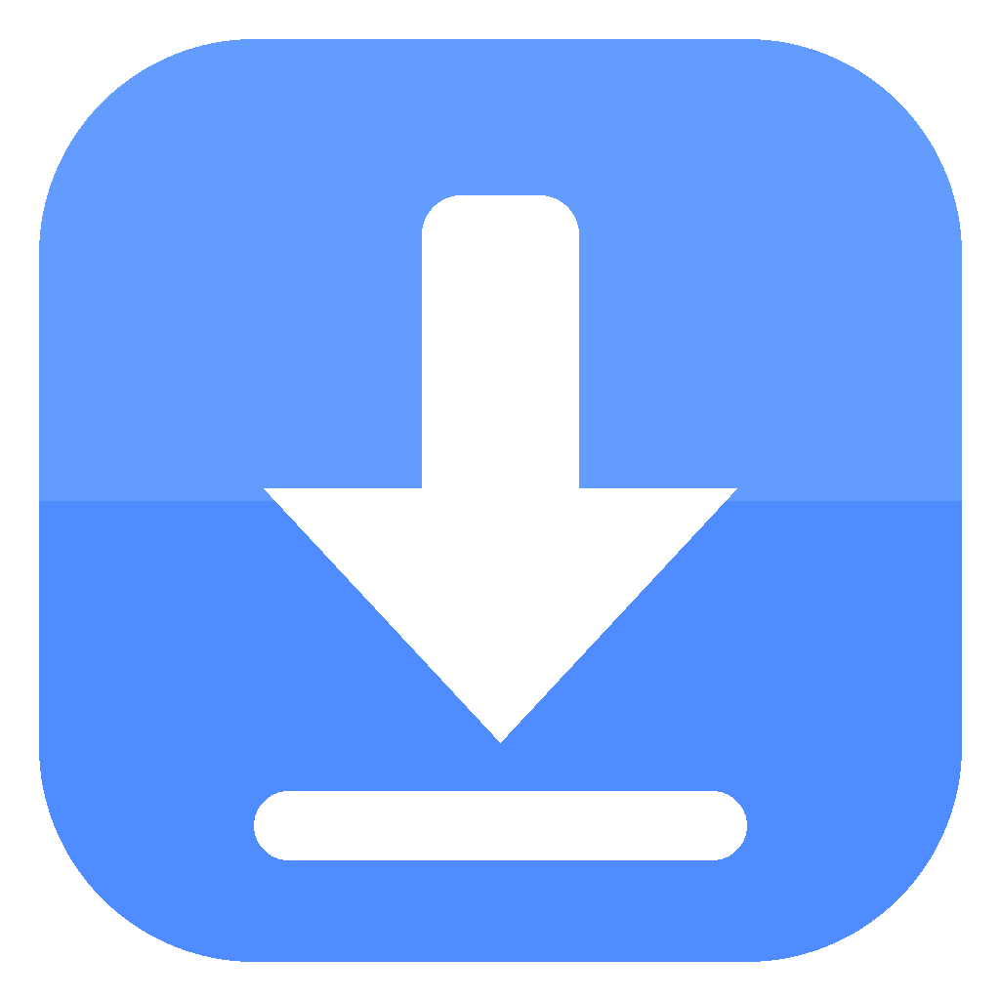
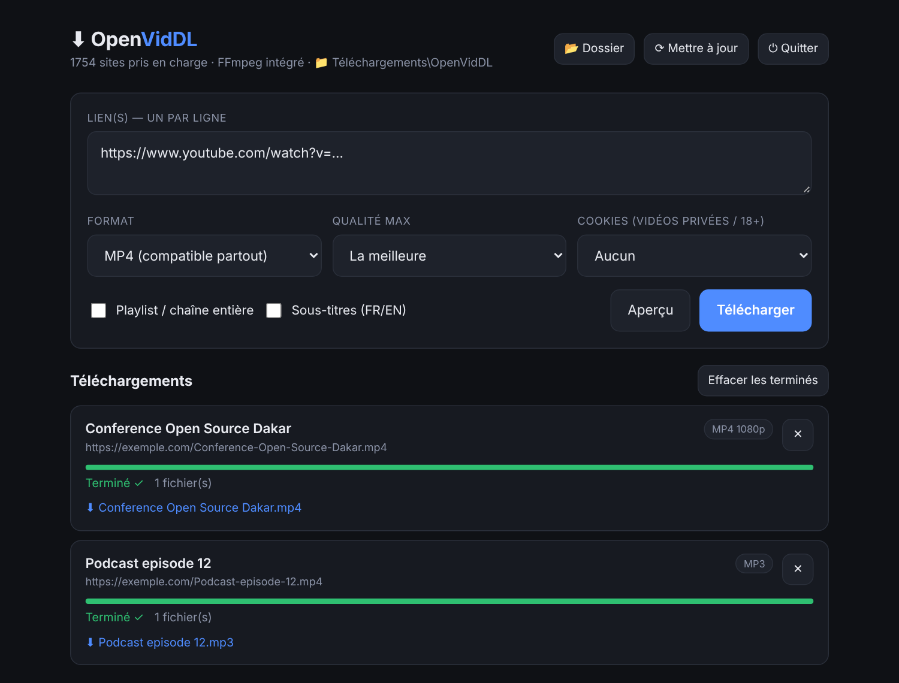
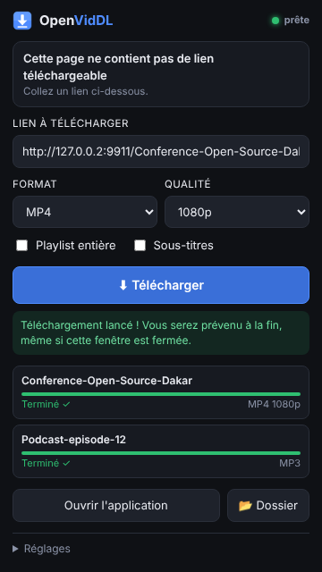

<div align="center">



# OpenVidDL

**Téléchargez des vidéos depuis plus de 1 700 sites, en MP4, MP3 et tous les formats courants.**<br>
Gratuit · Open source · Sans publicité · FFmpeg inclus

## ⬇️ Télécharger

<a href="https://github.com/AliouSignate/OpenVidDL/releases/download/v1.0.0/OpenVidDL-Setup-1.0.0.exe"></a>

<a href="https://github.com/AliouSignate/OpenVidDL/releases/download/v1.0.0/OpenVidDL-macOS.dmg"></a>
<a href="https://github.com/AliouSignate/OpenVidDL/releases/download/v1.0.0/OpenVidDL-Linux-x86_64.tar.gz"></a>
<a href="https://github.com/AliouSignate/OpenVidDL/releases/download/v1.0.0/OpenVidDL-Windows-portable.zip"></a>

<a href="https://github.com/AliouSignate/OpenVidDL/releases/latest/download/OpenVidDL-Extension.zip"></a>

<sub>Version 1.0.0 · <a href="https://github.com/AliouSignate/OpenVidDL/releases">toutes les versions</a> · aucun prérequis : ni Python, ni FFmpeg à installer</sub>

<br><br>



</div>

---

## ⚡ Installation en 3 étapes

1. **Téléchargez** le fichier de votre système avec les boutons ci-dessus.
2. **Installez-le** :
   - **Windows :** double-cliquez sur `OpenVidDL-Setup-…exe`, puis *Suivant* et *Installer*. Une icône apparaît sur le bureau, et aucun droit administrateur n'est demandé.
   - **macOS :** ouvrez le `.dmg` et glissez **OpenVidDL** dans *Applications*.
   - **Linux :** décompressez l'archive, puis lancez `./OpenVidDL`.
3. **Lancez OpenVidDL** : l'interface s'ouvre dans votre navigateur. Collez un lien, choisissez le format et cliquez sur **Télécharger**.

> **Avertissement au premier lancement :** l'application n'est pas signée par un certificat payant.
> - **Windows (SmartScreen) :** cliquez sur *Informations complémentaires*, puis *Exécuter quand même*.
> - **macOS :** faites un clic droit sur l'app, puis *Ouvrir* et *Ouvrir*. Si ça ne suffit pas, allez dans *Réglages Système → Confidentialité et sécurité* et cliquez sur *Ouvrir quand même*.

Les fichiers arrivent dans **Téléchargements/OpenVidDL**. Pour arrêter l'application, utilisez le bouton **⏻ Quitter**.

---

## 🧩 Extension navigateur



L'extension ajoute un bouton **OpenVidDL** dans la barre de votre navigateur et une entrée **« Télécharger avec OpenVidDL »** au clic droit sur une vidéo, un lien ou une page.

- **Un clic** sur l'icône envoie la vidéo de l'onglet ouvert, avec le format et la qualité de votre choix.
- **Clic droit** sur une vidéo, un lien ou une page : choix entre MP4 meilleure qualité, MP4 720p ou MP3.
- **Notification** à la fin du téléchargement, et **badge** qui affiche le nombre de téléchargements en cours.
- **Raccourci clavier** <kbd>Alt</kbd>+<kbd>Maj</kbd>+<kbd>D</kbd>.
- Si l'application est éteinte, l'extension la **démarre toute seule** (Windows et macOS).

> L'extension sert de télécommande pour l'application OpenVidDL, **qui doit donc être installée** (boutons ci-dessus). Un navigateur n'a pas le droit d'exécuter lui-même le moteur de téléchargement ni FFmpeg.

**Compatibilité :** Chrome, Edge, Brave, Opera, Vivaldi et autres navigateurs Chromium (version 121+), ainsi que Firefox 140+.

### Installation

**Chrome, Edge, Brave, Opera, Vivaldi**
1. Téléchargez [`OpenVidDL-Extension.zip`](https://github.com/AliouSignate/OpenVidDL/releases/latest/download/OpenVidDL-Extension.zip) et **décompressez-le** dans un dossier que vous garderez (par exemple `Documents\OpenVidDL-Extension`).
2. Ouvrez la page des extensions : `chrome://extensions` (Edge : `edge://extensions`, Opera : `opera://extensions`).
3. Activez le **Mode développeur**, en haut à droite (dans la barre de gauche sous Edge).
4. Cliquez sur **Charger l'extension non empaquetée**, puis sélectionnez le dossier décompressé.
5. Épinglez l'icône 📌 : cliquez sur la pièce de puzzle, puis sur l'épingle à côté d'OpenVidDL.

**Firefox**
- *Installation permanente :* installez `OpenVidDL-Extension-Firefox.xpi` s'il est présent dans la [dernière version](https://github.com/AliouSignate/OpenVidDL/releases/latest). Ce fichier signé par Mozilla est publié automatiquement dès que des clés de signature sont configurées (voir *Créer les exécutables*).
- *Test rapide :* allez sur `about:debugging#/runtime/this-firefox`, cliquez sur *Charger un module complémentaire temporaire…* et choisissez le fichier `manifest.json` du dossier décompressé. L'extension disparaît au redémarrage de Firefox.

> **Boutiques officielles :** l'extension peut être publiée gratuitement sur [Firefox Add-ons](https://addons.mozilla.org/developers/) et [Microsoft Edge Add-ons](https://partner.microsoft.com/dashboard/microsoftedge/). Le **Chrome Web Store** refuse en revanche les extensions qui téléchargent depuis YouTube : sur Chrome, il faut donc passer par l'installation ci-dessus.

<br clear="right">

---

## ✨ Fonctionnalités

- 🌍 **Plus de 1 700 sites** : YouTube, TikTok, Instagram, Facebook, X/Twitter, Vimeo, Dailymotion, Twitch, Reddit, SoundCloud, Bilibili, sites d'actualités… ainsi que les liens directs vers des fichiers vidéo et les flux HLS/DASH (`.m3u8`, `.mpd`).
- 🎞 **Tous les formats courants** :
  - vidéo : **MP4**, **MKV**, **WEBM**, **MOV**, **AVI**, ou l'original sans conversion ;
  - audio seul : **MP3**, **M4A/AAC**, **OPUS**, **FLAC**, **WAV**, **OGG**.
- 📺 Qualité au choix, de 144p jusqu'à 8K.
- 📚 Playlists et chaînes entières, plusieurs liens à la fois (un par ligne), 3 téléchargements en parallèle.
- 💬 Sous-titres FR/EN intégrés dans la vidéo, métadonnées et chapitres conservés.
- 🔐 Vidéos privées ou réservées aux membres, en réutilisant la session de votre navigateur (option *Cookies*).
- 📱 Accessible depuis votre téléphone sur le réseau local (option `--host 0.0.0.0`).
- 🖥 Windows, macOS, Linux et Docker. Aucune publicité, aucun traçage.

Le moteur est [yt-dlp](https://github.com/yt-dlp/yt-dlp), et les conversions sont faites par [FFmpeg](https://ffmpeg.org).

---

## 🐍 Autres méthodes d'installation

### Depuis le code source (Python 3.10+)

| Windows | macOS / Linux |
|---|---|
| Double-cliquez sur `install.bat`, puis sur `run.bat` | `./install.sh` puis `./run.sh` |

> Sur Debian/Ubuntu, si l'installeur le demande : `sudo apt install python3 python3-venv`

### Docker (serveur, NAS…)
```bash
docker compose up -d
# puis ouvrez http://localhost:8765. Les fichiers arrivent dans ./downloads
```

---

## 🏗 Créer les exécutables

### Automatiquement avec GitHub (recommandé, gratuit)
Le fichier `.github/workflows/build.yml` compile Windows, macOS et Linux sur les serveurs de GitHub :

1. Créez un dépôt sur GitHub et envoyez-y ce dossier (`git init`, `git add .`, `git commit -m "OpenVidDL"`, `git push`).
2. Ouvrez l'onglet **Actions** : la compilation démarre seule (environ 10 minutes). Les exécutables sont ensuite téléchargeables dans la section **Artifacts**.
3. Pour une version officielle, cliquez sur **Releases**, puis **Create a new release**. Saisissez un tag (ex. `v1.0.0`) et cliquez sur **Publish release**. Environ 10 minutes plus tard, l'installateur `.exe`, la version portable, le `.dmg` et le binaire Linux sont ajoutés automatiquement à la release.

**Signature automatique de l'extension Firefox (facultatif) :** créez des clés API sur <https://addons.mozilla.org/developers/addon/api/key/>. Ajoutez-les ensuite au dépôt (*Settings → Secrets and variables → Actions*) sous les noms `AMO_JWT_ISSUER` et `AMO_JWT_SECRET`. Chaque release contiendra alors un `OpenVidDL-Extension-Firefox.xpi` signé, installable de façon permanente.

### Sur votre propre ordinateur
Chaque système ne peut compiler que pour lui-même : le `.exe` se fabrique sous Windows, le `.dmg` sous macOS.

- **Windows :** installez Python 3.10+ et [Inno Setup 6](https://jrsoftware.org/isdl.php), puis double-cliquez sur **`build_windows.bat`**. Le résultat est `dist\OpenVidDL-Setup-x.y.z.exe`.
- **macOS / Linux :** lancez `pip install -r requirements.txt pyinstaller`, puis `python build.py`.

---

## 📖 Utilisation

1. Collez un ou plusieurs liens (un par ligne).
2. Cliquez sur *Aperçu* pour vérifier la vidéo (facultatif).
3. Choisissez le **format** et la **qualité**, puis cliquez sur **Télécharger** (raccourci : Ctrl+Entrée).
4. Les fichiers arrivent dans **`Téléchargements/OpenVidDL`**. Le bouton 📂 *Dossier* l'ouvre directement, et chaque fichier peut aussi être récupéré depuis la liste.

### Options de lancement
| Commande | Effet |
|---|---|
| `run.sh --output ~/Vidéos` | Change le dossier de destination |
| `run.sh --port 9000` | Change le port |
| `run.sh --host 0.0.0.0` | Rend l'application accessible depuis les autres appareils du réseau local, comme votre téléphone (à utiliser uniquement sur un réseau de confiance) |
| `run.sh --no-browser` | N'ouvre pas le navigateur automatiquement |

Sous Windows, remplacez `run.sh` par `run.bat`. Variables d'environnement équivalentes : `OPENVIDDL_DIR`, `OPENVIDDL_PORT`, `OPENVIDDL_HOST`, `OPENVIDDL_PARALLEL`.

---

## 🛠 Dépannage

| Problème | Solution |
|---|---|
| Un site qui marchait ne marche plus / « HTTP Error 403 » | Les sites changent souvent. Cliquez sur **⟳ Mettre à jour**, puis relancez l'application. Cela fonctionne aussi avec la version installée par le .exe, sans réinstaller. |
| « Sign in to confirm », vidéo privée ou 18+ | Connectez-vous au site dans votre navigateur, puis choisissez ce navigateur dans **Cookies**. Fermez Chrome/Edge avant si une erreur de base de données apparaît. |
| « FFmpeg absent » | Relancez l'installation, ou installez FFmpeg vous-même (`winget install ffmpeg`, `brew install ffmpeg`, `sudo apt install ffmpeg`). |
| Netflix, Disney+, Prime Video, Spotify… | Ces contenus sont protégés par DRM : ils ne peuvent pas être téléchargés, et c'est voulu. |

---

## ⚖️ Usage responsable

OpenVidDL est un outil. Ne téléchargez que des contenus dont vous détenez les droits, des contenus sous licence libre, ou des copies autorisées pour un usage privé selon la loi de votre pays. Respectez aussi les conditions d'utilisation des plateformes. Les auteurs déclinent toute responsabilité en cas d'usage abusif.

## 🤝 Contribuer

Tout le code tient dans **`app.py`** (serveur Flask + yt-dlp) et **`templates/index.html`** (interface). La compilation est gérée par `build.py` (PyInstaller) et `installer/OpenVidDL.iss` (Inno Setup). Les *issues* et *pull requests* sont les bienvenues.

```bash
python -m venv .venv && . .venv/bin/activate
pip install -r requirements.txt
python app.py
```

## 📄 Licence

[MIT](LICENSE). Vous pouvez utiliser, modifier et redistribuer ce code librement.
